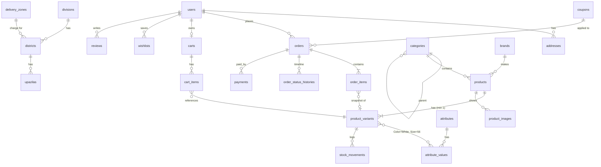

# Database Design — Phase 1

> Status: **Accepted** ([ADR-007](decisions/ADR-007-database-design-phase-1.md)). Migrations are written per feature.
> Store settings live in a `settings` table ([ADR-011](decisions/ADR-011-settings-table.md)).

Built from the approved prototype (`nischoyota-frontend/`) for the Bangladesh market.
It is a single-vendor store, but the design leaves room for multi-vendor and dropshipping later (see [§6](#6-future-phases-not-built-now)).

## 1. Overview

29 tables in 7 groups, plus the Laravel system tables that already exist.

| Group | Tables |
|---|---|
| Auth & users | `users`, `otp_codes`, `password_reset_tokens`, `sessions` |
| Locations & delivery | `divisions`, `districts`, `upazilas`, `delivery_zones`, `addresses` |
| Catalog | `categories`, `brands`, `products`, `product_images`, `attributes`, `attribute_values`, `product_variants`, `attribute_value_product_variant` |
| Inventory | `stock_movements` |
| Shopping | `carts`, `cart_items`, `wishlists`, `reviews` |
| Orders & payments | `coupons`, `orders`, `order_items`, `order_status_histories`, `payments` |
| Content | `pages`, `contact_messages` |
| Laravel system | `cache`, `jobs` (already exist) |

## 2. Key decisions (need approval)

| # | Decision | Why (Bangladesh market) |
|---|---|---|
| D1 | **Phone is the main login ID.** Email is optional. Login with phone **or** email + password. | Many customers use phone only. The prototype login already says "Phone Number or Email". |
| D2 | **OTP by SMS** in only 3 places: verify phone at registration, reset password by phone, and **confirm a guest COD order** from an unverified phone. | Fake COD orders are the #1 loss for BD shops. OTP only where it pays off keeps SMS cost low. |
| D3 | **Guest checkout allowed.** `orders.user_id` is nullable. Guests track an order with order number + phone. | Matches checkout and order-tracking pages. Forcing signup lowers conversion. |
| D4 | **Money = unsigned integer in paisa** (৳4,850 → `485000`). Currency is BDT only. | No float errors, no extra package. Percent coupons create fractions, so whole taka is not enough. |
| D5 | **Every product has at least one variant.** Price, SKU and stock live on the variant. A simple product has one default variant. | One code path for cart, stock and orders. The prototype has Color/Size/Wattage options. |
| D6 | **Orders store snapshots** (customer, address, product name, price). They do not depend on live data. | Old orders must not change when a product price or address is edited. |
| D7 | **Location tables** (8 divisions, 64 districts, ~495 upazilas) seeded once, with Bangla names. Delivery charge comes from a **delivery zone**. | Checkout uses Division → District → Upazila dropdowns. Couriers (Pathao, Steadfast, RedX) price by Inside Dhaka / Sub-Dhaka / Outside Dhaka. |
| D8 | **Roles are a column on `users`** (`customer`, `staff`, `admin`). No permission package. | Enough for Phase 1. Vendors get their own tables in Phase 2. |
| D9 | Statuses and types are **string columns cast to PHP enums** (no MySQL `ENUM`). | Already in `rules.md` §6. |

## 3. Tables

Conventions: every table has `id` (bigint) and `created_at` / `updated_at` unless noted.
FK = foreign key. `money` = `unsignedBigInteger`, in paisa.

### 3.1 Auth & users

**users**: change the Laravel default table.

| Column | Type | Notes |
|---|---|---|
| name | string | |
| phone | string(11), unique | Stored as `01XXXXXXXXX`. Normalise `+880`/`880` on input. |
| email | string, nullable, unique | Optional |
| phone_verified_at | timestamp, nullable | Set after OTP |
| email_verified_at | timestamp, nullable | |
| password | string | |
| role | string, index | `UserRole`: customer, staff, admin |
| status | string | `UserStatus`: active, blocked (block fake-order abusers) |
| last_login_at | timestamp, nullable | |
| remember_token | | Laravel default |

**otp_codes** (migrated in F-014; `recipient` + `channel` replace the planned `phone`, so password-reset codes can also go by email)

| Column | Type | Notes |
|---|---|---|
| recipient | string, index | Phone `01XXXXXXXXX` or email |
| channel | string | `OtpChannel`: sms, email |
| purpose | string | `OtpPurpose`: phone_verification, password_reset (order_confirmation, phone_change added later) |
| code_hash | string | Store a hash, never the plain code |
| attempts | unsignedTinyInteger | Dead after 5 wrong tries |
| expires_at | timestamp | 5 minutes |
| verified_at | timestamp, nullable | |
| ip_address | string(45), nullable | |

Send rate is limited with Laravel `RateLimiter` (e.g. 1 SMS per 60 s, 5 per hour per phone), so no table is needed for it.
The SMS provider (SSL Wireless, Alpha SMS, BulkSMSBD…) goes behind one service. That is a separate decision.

**password_reset_tokens**, **sessions**: Laravel defaults. Password reset uses OTP codes for both phone and email (F-014), so `password_reset_tokens` is unused.

### 3.2 Locations & delivery

**delivery_zones** (migrated in F-009): Inside Dhaka ৳60 (1–2 days), Dhaka Suburbs ৳100 (2–3 days), Outside Dhaka ৳120 (3–5 days); plus `sort_order`

| Column | Type | Notes |
|---|---|---|
| name | string | |
| charge | money | |
| min_days, max_days | unsignedTinyInteger | For "Estimated delivery: 2–5 days" |
| is_active | boolean | |

The free-delivery threshold (৳2,000) is a store setting ([ADR-011](decisions/ADR-011-settings-table.md)).

**divisions**: `name`, `name_bn`. No timestamps, seeded.

**districts**: `division_id` FK, `name`, `name_bn`, `delivery_zone_id` FK. Seeded.

**upazilas** (migrated in F-009; 494 upazilas + 50 Dhaka city thanas from `database/data/bangladesh` + `LocationSeeder`): `district_id` FK, `name`, `name_bn`, `delivery_zone_id` FK **nullable**. This overrides the district's zone, for example Savar is Sub-Dhaka while Dhanmondi is Inside Dhaka.

**addresses** (migrated in F-015; max 10 per customer, one default)

| Column | Type | Notes |
|---|---|---|
| user_id | FK, cascade delete | |
| label | string | `AddressLabel`: home, office, other |
| recipient_name | string | |
| phone | string(11) | |
| division_id, district_id, upazila_id | FK | |
| area | string, nullable | |
| address_line | string | House, road, landmark |
| postal_code | string(10), nullable | |
| is_default | boolean | |

### 3.3 Catalog

**categories** (migrated in F-003): `parent_id` (nullable, self FK, restrict delete, two levels only), `name`, `slug` unique, `image`, `sort_order`, `is_active`, `meta_title`, `meta_description`.

**brands** (migrated in F-004): `name` unique, `slug` unique, `logo` nullable, `is_active`.

**products** (migrated in F-006)

| Column | Type | Notes |
|---|---|---|
| category_id | FK, restrict delete | |
| brand_id | FK, nullable | |
| name, slug | string, slug unique | |
| short_description | text, nullable | |
| description | longText | |
| specifications | json, nullable | `[{"label":"Motor","value":"100% Copper"}]` |
| status | string, index | `ProductStatus`: draft, active, archived |
| is_featured | boolean, index | "Featured Products" on home |
| allow_preorder | boolean | "Pre-order" filter |
| min_price | money, index | Lowest variant price, cached by the service for sorting and price filters |
| max_discount_percent | unsignedTinyInteger, index | Cached for the "Discount 10%+" filter and the Deals page |
| rating_average | decimal(3,2) | Cached from approved reviews |
| rating_count, sold_count | unsignedInteger | `sold_count` → "Best seller" and "Popular" sort |
| meta_title, meta_description | string, nullable | SEO |
| published_at | timestamp, nullable | "Newest" sort, "NEW" badge |

**product_variants** (migrated in F-006; F-006 creates only the default variant)

| Column | Type | Notes |
|---|---|---|
| product_id | FK, cascade delete | |
| sku | string, unique | `NS-EL-0034` |
| price | money | Selling price |
| compare_price | money, nullable | Old price (strikethrough) |
| cost_price | money, nullable | Admin only, for profit reports |
| stock_quantity | integer | Current stock |
| weight_grams | unsignedInteger, nullable | Courier charges by weight later |
| is_default | boolean | |
| is_active | boolean | |

**attributes** (migrated in F-005, model `ProductAttribute`): `name` unique (Color, Size, Wattage), `slug` unique.
**attribute_values** (migrated in F-005): `attribute_id` FK cascade, `value` (White, 56") unique per attribute, `color_hex` char(7) nullable (`#RRGGBB`, for the swatch), `sort_order`.
**attribute_value_product_variant** (migrated in F-007): pivot with `product_variant_id` (FK, cascade) and `attribute_value_id` (FK, **restrict**, so a value in use cannot be deleted), composite primary key. This powers the Color and Size filters on the shop page.

**product_images** (migrated in F-006): `product_id` FK, `path`, `alt`, `sort_order`. A variant's own photo is `product_variants.product_image_id` (F-007), so one photo can serve several variants.

### 3.4 Inventory

**stock_movements** (migrated in F-008, plus `stock_after` = balance after the change): an audit log. The live number is `product_variants.stock_quantity`.

| Column | Type | Notes |
|---|---|---|
| product_variant_id | FK | |
| quantity_change | integer | `+50` restock, `-2` sold |
| reason | string | `StockMovementReason`: restock, order_placed, order_cancelled, returned, adjustment |
| order_id | FK, nullable | |
| user_id | FK, nullable | Admin who made the change |
| note | string, nullable | |
| created_at | timestamp | No `updated_at`. Rows are never edited. |

### 3.5 Shopping

**carts**: `user_id` nullable unique FK, `session_id` nullable index (guest). When a guest logs in, the guest cart is merged into the user's cart.
**cart_items**: `cart_id` FK cascade, `product_variant_id` FK cascade, `quantity`, unique(`cart_id`, `product_variant_id`). **No price is stored.** Prices always come from the variant (`rules.md` §8).

**wishlists**: `user_id` FK, `product_id` FK, unique(`user_id`, `product_id`), `created_at`.

**reviews** (migrated in F-027; `is_verified_purchase` is set when the review is saved instead of an `order_item_id`)

| Column | Type | Notes |
|---|---|---|
| product_id, user_id | FK, cascade | unique(product_id, user_id); index (product_id, status) |
| rating | unsignedTinyInteger | 1–5 |
| comment | text | Plain text |
| is_verified_purchase | boolean | Customer had a delivered order with the product |
| status | string | `ReviewStatus`: pending, approved, rejected |
| moderated_by, moderated_at | FK users (null on delete), timestamp | Who approved / rejected |

`products.rating_average` / `rating_count` cache the approved reviews (`ProductService::updateRatingCache()`).

### 3.6 Orders & payments

**coupons** (migrated in F-011; dates are stored in UTC and entered as Bangladesh days, `config('shop.timezone')`)

| Column | Type | Notes |
|---|---|---|
| code | string, unique | `SAVE120` |
| type | string | `CouponType`: fixed, percent |
| value | unsignedInteger | Paisa if fixed, % if percent |
| min_order_amount | money, nullable | |
| max_discount_amount | money, nullable | Cap for percent coupons |
| usage_limit, usage_limit_per_user | unsignedInteger, nullable | Checked by counting `orders.coupon_id` |
| used_count | unsignedInteger | |
| starts_at, expires_at | timestamp, nullable | |
| is_active | boolean | |

**orders**

| Column | Type | Notes |
|---|---|---|
| order_number | string, unique | `ORD-10025` |
| user_id | FK, nullable, null on delete | Null = guest |
| customer_name, customer_phone, customer_email | string | Snapshot. `customer_phone` indexed (tracking and fraud checks). |
| shipping_division, shipping_district, shipping_upazila | string | Names snapshot |
| shipping_district_id, shipping_upazila_id | FK, nullable | For reports |
| shipping_area, shipping_address, shipping_postal_code | string | Snapshot |
| delivery_zone_id | FK, nullable | |
| subtotal, discount_amount, shipping_fee, total | money | Calculated on the server only |
| coupon_id | FK, nullable | |
| coupon_code | string, nullable | Snapshot |
| status | string, index | `OrderStatus`: pending, confirmed, processing, shipped, out_for_delivery, delivered, cancelled, returned |
| payment_method | string | `PaymentMethod`: cod (now); bkash, nagad, card (later) |
| payment_status | string, index | `PaymentStatus`: unpaid, paid, partially_refunded, refunded |
| is_phone_verified | boolean | OTP done for this order (D2) |
| courier_name, tracking_code | string, nullable | Pathao / Steadfast / RedX consignment (migrated in F-025, with `admin_note`, `delivered_at`, `cancelled_at`) |
| customer_note, admin_note | text, nullable | |
| ip_address | string(45), nullable | Fraud checks |
| placed_at | timestamp, index | |
| delivered_at | timestamp, nullable | The 7-day return window starts here |
| cancelled_at | timestamp, nullable | |
| cancellation_reason | string, nullable | |

**order_items**

| Column | Type | Notes |
|---|---|---|
| order_id | FK, cascade delete | |
| product_id, product_variant_id | FK, nullable, null on delete | Kept even if the product is deleted |
| product_name, variant_label, sku, image | string | Snapshot: "Color: White" |
| unit_price | money | Price at order time |
| quantity | unsignedInteger | |
| line_total | money | |

**order_status_histories**: `order_id` FK cascade, `status`, `note` nullable ("handed to courier"), `changed_by` FK users nullable, `created_at`. This feeds the "Status Timeline" on the order pages.

**payments**

| Column | Type | Notes |
|---|---|---|
| order_id | FK | |
| method | string | `PaymentMethod` |
| amount | money | |
| status | string | `PaymentTransactionStatus`: pending, success, failed, refunded |
| transaction_id | string, nullable, index | bKash TrxID / gateway ID |
| gateway_response | json, nullable | Raw callback for disputes |
| paid_at | timestamp, nullable | For COD: when the courier collects the cash |

Refunds (bKash/Nagad per the returns policy) are payment rows with status `refunded`. Phase 1 has no separate returns table. Returns are handled by support and recorded with `status = returned`, a stock movement and a refund payment.

### 3.7 Content

**settings** (migrated in F-010, ADR-011): `key` unique (`StoreSetting` enum), `value` json. Read through the cached `SettingService`.

**pages** (migrated in F-012; body is Markdown, plus `subtitle` and `is_system`): `slug` unique, `title`, `body` (longText), `meta_title`, `meta_description`, `is_published`. Used for privacy, terms, shipping, returns, about and FAQ.
**contact_messages**: `user_id` nullable, `name`, `phone`, `email` nullable, `subject` (`ContactSubject`: order_issue, product_question, return_request, other), `message`, `status` (new, replied, closed).

## 4. Main flows on this schema

| Flow | Tables |
|---|---|
| Register | `users` → `otp_codes` (register) → `users.phone_verified_at` |
| Forgot password | Phone: `otp_codes` (password_reset). Email: `password_reset_tokens` |
| Checkout | Read `cart_items` + `product_variants` → recalculate totals + zone charge + coupon → in one DB transaction: insert `orders`, `order_items`, `order_status_histories`, decrement `stock_quantity`, insert `stock_movements`, clear the cart |
| Guest COD order | Same as checkout, plus an `otp_codes` (order_confirmation) check → `orders.is_phone_verified` |
| Track order | `orders` where `order_number` + `customer_phone` |
| Cancel | Status → cancelled, restock with a `stock_movements` row (order_cancelled) |

## 5. Indexes to note

- `products (status, category_id)`, `products (status, min_price)`, `products (status, published_at)`
- `orders (user_id, placed_at)`, `orders (status, placed_at)`, `orders (customer_phone)`
- `otp_codes (phone, purpose, created_at)`
- Search (F-018) uses word-by-word `LIKE` over name, SKU, brand and category. A MySQL `FULLTEXT(name)` index is postponed to F-030: InnoDB FULLTEXT ignores uncommitted rows, so it cannot be tested inside transactions, and the catalogue is small

## 6. Future phases (not built now)

Per [ADR-005](decisions/ADR-005-phase-1-single-vendor.md) and [ADR-006](decisions/ADR-006-vendor-agnostic-core.md), none of the following exists in Phase 1.
The Phase 1 design makes each step an **additive** migration:

| Phase | Added later | Why Phase 1 already fits |
|---|---|---|
| 2 — Multi-vendor | `vendors`, `vendor_users`, `products.vendor_id`, `order_items.vendor_id`, `vendor_orders` (one sub-order per vendor, with its own status, shipping and courier), `commissions`, `vendor_payouts` | Items are snapshotted per line, stock lives on the variant, and totals and shipping are computed in services. Splitting per seller does not need a redesign. |
| 3 — Dropshipping | `suppliers`, `supplier_products` (supplier SKU + cost), `purchase_orders` sent to the supplier | `cost_price` already exists. Fulfilment moves from `orders` courier fields to sub-orders. |

## 7. Next steps after approval

1. Record D1–D9 as ADRs (`decisions/`).
2. Create migrations **per feature**, not all at once: Auth & account first (users, otp_codes, locations, addresses), then Catalog, and so on.
